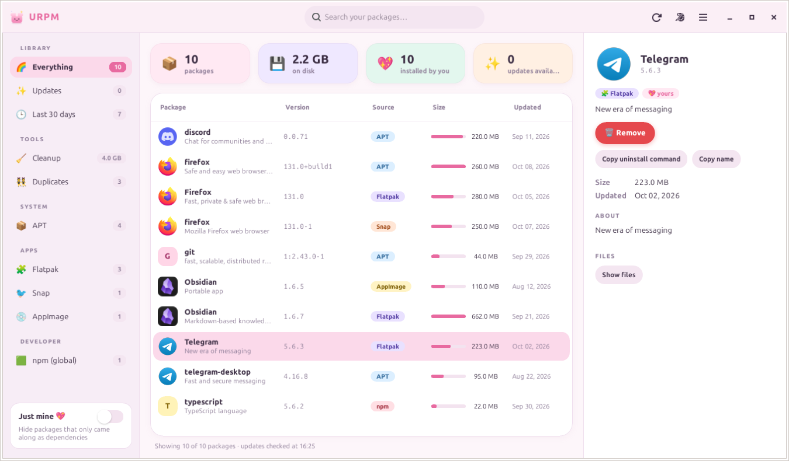
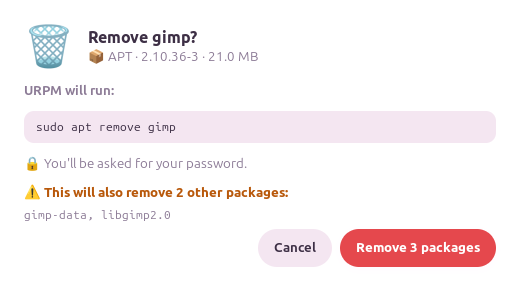
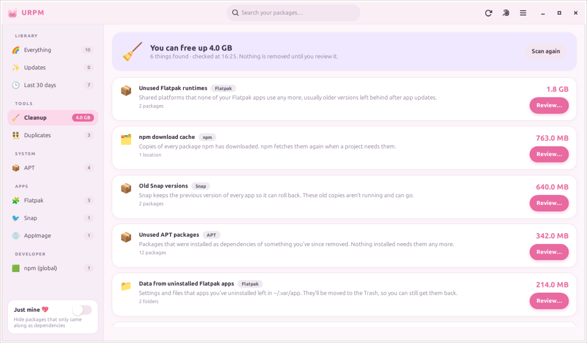
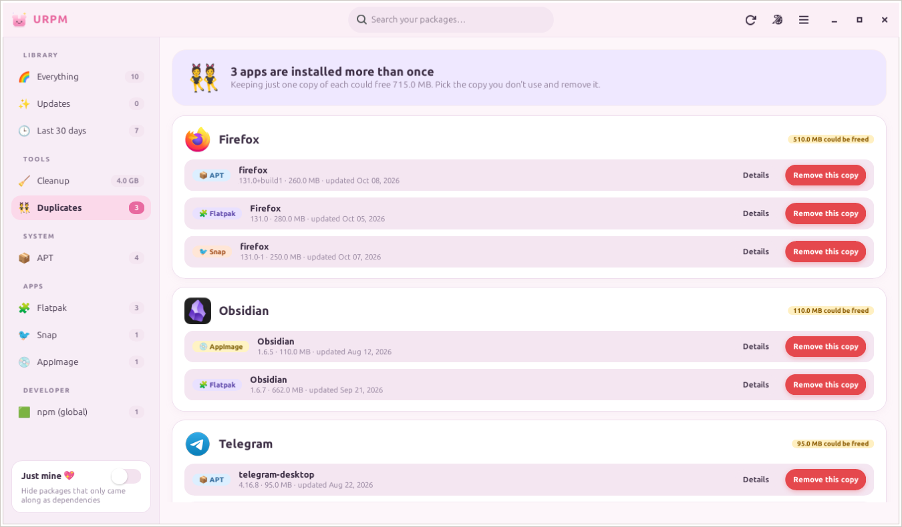
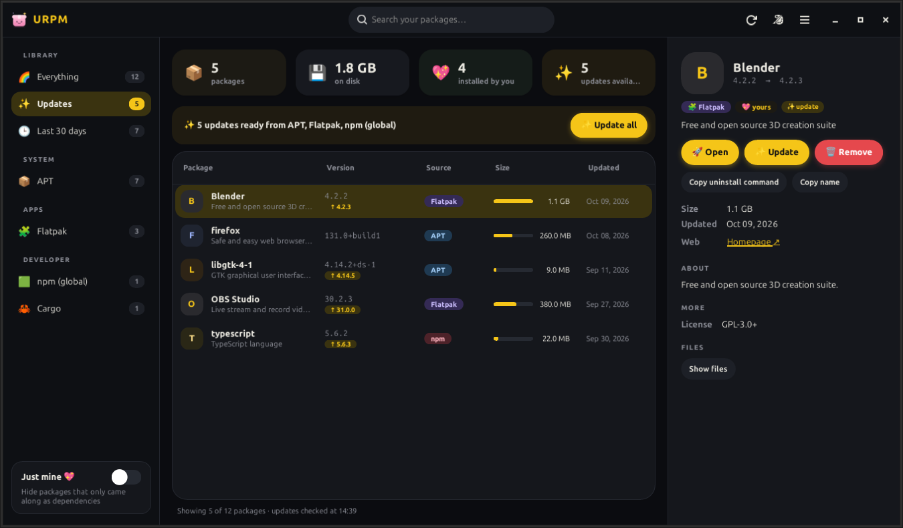
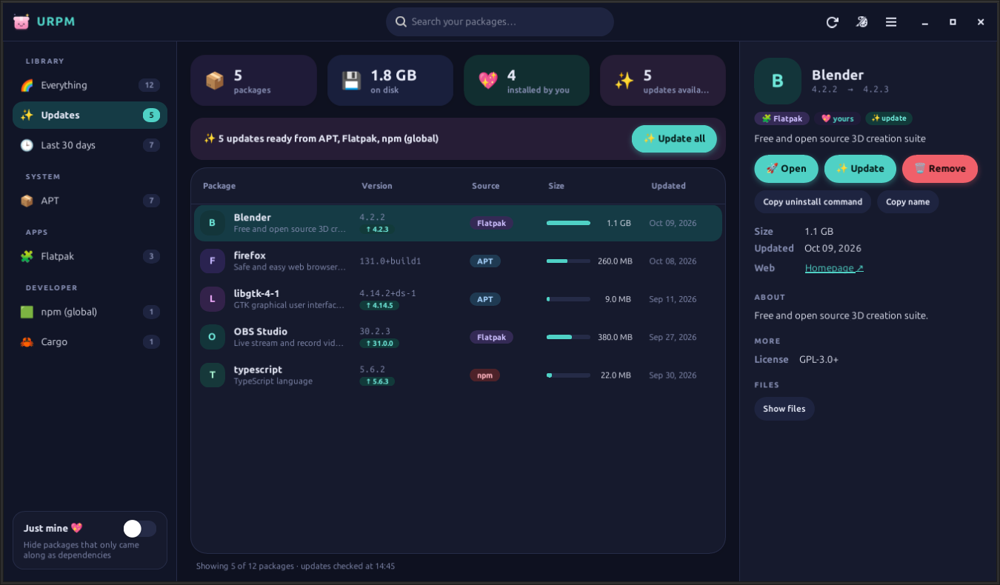
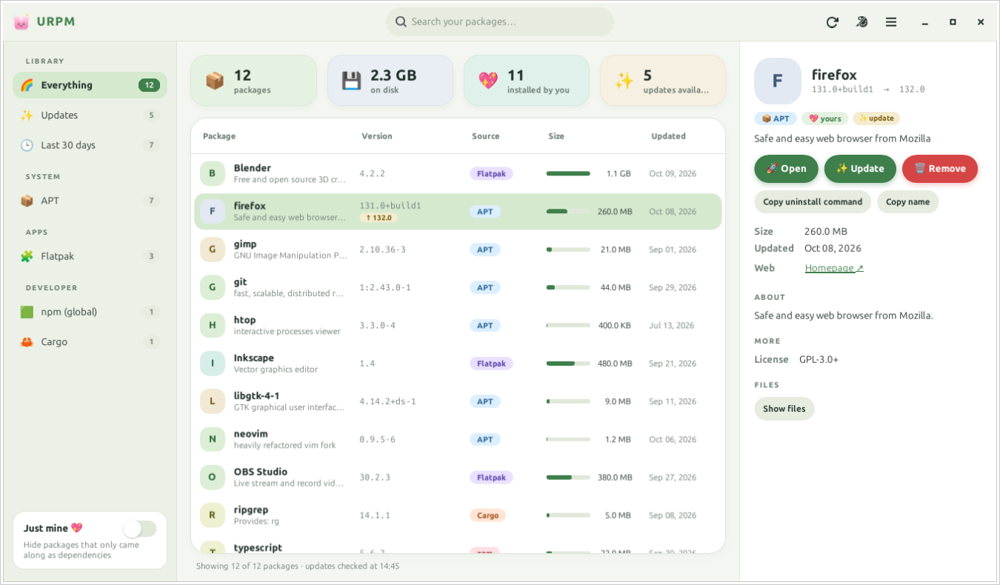
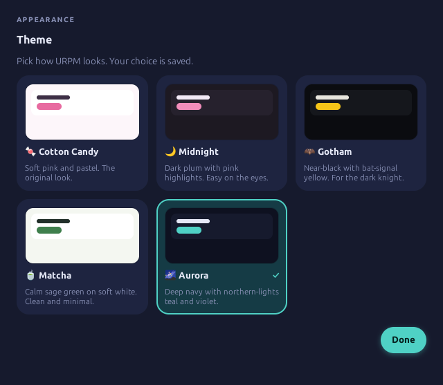

<div align="center">


# URPM

**Every package on your Linux machine, in one cute little window.**

APT · DNF · pacman · Flatpak · Snap · AppImage · Homebrew · Nix · pip · npm · Cargo · and more

[](https://github.com/MrNaji1/URPM/actions/workflows/ci.yml)
[](https://github.com/MrNaji1/URPM/releases/latest)
[](LICENSE)



</div>

## What is URPM for?

Linux machines collect software from lots of places. There's your distro's package manager,
plus Flatpak and Snap apps, AppImages sitting in `~/Downloads`, Python tools from pip,
global npm packages, Rust tools from Cargo… Each one has its own commands, and none of them
can show you the whole picture.

**URPM puts it all in one place.** Open it and you can instantly answer questions like:

- 🤔 *"What have I actually installed on this computer?"* Flip on **Just mine** to hide
  the thousands of libraries that came along as dependencies.
- 💾 *"What's eating my disk?"* Sort by size across every package manager at once, or
  open the **Cleanup centre** to free space in a click.
- 👯 *"Why do I have Firefox three times?"* The **Duplicate finder** shows apps installed
  through more than one package manager.
- 🔗 *"Why is this library here?"* Every package shows what **needs** it.
- ✨ *"What needs updating?"* One view shows updates from APT, Flatpak, Snap, npm and more.
- 🕒 *"What changed recently?"* That's handy when something broke after an install.
- 🧹 *"How do I get rid of this?"* Remove it right there, after URPM shows you exactly
  what else would be removed.
- 📋 *"What do I need to set up my new laptop?"* Export your list to CSV, JSON or text.

## Features

| | |
|---|---|
| 🌈 **One list for everything** | 16 package managers, detected automatically. No setup. |
| 🔍 **Instant search** | Just start typing. Searches names, IDs and descriptions. |
| 💖 **Just mine** | Hides packages that were only pulled in as dependencies. |
| ✨ **Update checker** | Finds updates across all your package managers in the background. |
| 🛡 **Security updates stand out** | Security fixes get a red 🛡 badge, so you know which updates matter most (APT, DNF and pacman with `arch-audit`). |
| 📌 **Keep this version** | Hold a package so it isn't updated (APT, DNF, Flatpak, Homebrew). Held packages are skipped by *Update all*. |
| 🕘 **History** | A timeline of everything installed, updated or removed, grouped by day, read from your package managers' own logs. |
| 🔔 **Background update checks** | Optional. Every 6 hours URPM checks quietly and sends a notification when new updates appear, without keeping a window open. |
| 🔄 **Update all** | One click (and one password prompt per package manager) updates everything in the Updates view. |
| 🚀 **Open apps** | Launch Flatpaks, Snaps, AppImages and desktop apps. Double-click a row or press Enter. |
| 🗑️ **Safe removal** | Previews everything that would be removed *before* you confirm, then asks for your password through polkit. |
| 🧹 **Cleanup centre** | Unused packages, unused Flatpak runtimes, old Snap versions, and APT, DNF, pacman, pip, npm, Cargo and Homebrew caches, with a "free up X GB" total. Everything is previewed before it's removed. |
| 👯 **Duplicate finder** | Spots the same app installed through APT, Flatpak, Snap, AppImage… and how much space the extra copies use. |
| 🔗 **Needed by** | Shows which installed packages depend on each package, and flags the ones nothing needs any more. |
| 🖼️ **Real app icons** | Apps show their own icons, taken from their desktop entries. |
| 📂 **File lists** | See which files a package put on your system. |
| 📊 **Stats** | Package count, disk usage, how many you installed, and pending updates. |
| 📤 **Export** | Save the current view as CSV, JSON or plain text. |
| 🎨 **Themes** | Five themes in Settings: 🍬 Cotton Candy, 🌙 Midnight, 🦇 Gotham, 🍵 Matcha and 🌌 Aurora. |
| 📐 **Fits small screens** | Columns tuck away on narrower windows; works down to ~730 px wide. |
| ⌨️ **Keyboard friendly** | `Ctrl+F` search, `Ctrl+R` reload, `Ctrl+U` updates, `Ctrl+E` export, `Delete` to remove. |

<div align="center">

</div>

## Cleanup and duplicates

**🧹 Cleanup** adds up everything you can safely remove. Each item opens a preview
showing every package, folder or cache it will remove, plus the exact commands, before
anything happens. Data from uninstalled Flatpak apps goes to the Trash, so you can get it
back.

| What | How URPM finds it |
|---|---|
| Unused packages | `apt-get -s autoremove`, `pacman -Qdtq`, `dnf repoquery --unneeded` (all read-only) |
| Unused Flatpak runtimes | platforms and SDKs no installed app uses (never GL drivers or other extensions) |
| Leftover Flatpak data | folders in `~/.var/app` for apps that aren't installed |
| Old Snap versions | disabled revisions in `snap list --all` |
| Download caches | APT, DNF, pacman (`paccache` dry run), pip, npm, Cargo, Homebrew (`brew cleanup -n`) |

**👯 Duplicates** groups apps installed more than once, even under different names
(`telegram-desktop` from APT is the same app as `org.telegram.desktop` from Flathub).

<div align="center">

<br><br>

</div>

## Staying up to date

**🕘 History** in the sidebar's *Tools* section shows what changed on your system and when,
newest first. Filter it by *Installed*, *Updated* or *Removed*, search it like the package
list, and turn on *Just mine* to hide packages that came in as dependencies.

| Package manager | Where the history comes from |
|---|---|
| APT | `/var/log/apt/history.log` (and its rotated copies) |
| pacman | `/var/log/pacman.log` |
| DNF / zypper | `/var/log/dnf.rpm.log`, `/var/log/zypp/history` |
| Flatpak | `flatpak history` |
| Snap | `snap changes` |

**🛡 Security updates** are marked in red in the list, the details panel and the Updates
banner. URPM finds them through `-security` suites on APT, `dnf updateinfo --security` on
Fedora, and `arch-audit` on Arch (if it's installed).

**📌 Keep this version** in the details panel holds a package at its current version
(`apt-mark hold`, `dnf versionlock`, `flatpak mask`, `brew pin`). Press
*Allow updates again* to release it.

**🔔 Background checks** are off by default. Turn them on in **Settings → Updates**. On
systems with systemd, URPM adds a small user timer (no root needed) that runs
`urpm --check-updates` 15 minutes after login and then every 6 hours. Without systemd it
checks once, 10 minutes after login. You're only notified about updates you haven't
already been told about. Turning the switch off removes the timer again.

## Themes

Open **Settings** (the brush button, or `Ctrl+,`) and pick the look you like. Your choice
is remembered.

| | |
|:-:|:-:|
| <br>🦇 **Gotham**: near-black with bat-signal yellow | <br>🌌 **Aurora**: deep navy with northern-lights teal |
| <br>🍵 **Matcha**: calm sage green, clean and minimal | <br>🍬 **Cotton Candy**: the original soft pink |

<div align="center">

<br><sub>🌙 <b>Midnight</b>, dark plum with pink, is in there too.</sub>

</div>

## Supported package managers

URPM checks which of these you have and shows only those. Missing a package manager is
never an error.

### 🖥️ Distro package managers

| Package manager | Distros | List | Update check | Remove | Update | Files |
|---|---|:-:|:-:|:-:|:-:|:-:|
| 📦 **APT / dpkg** (`.deb`) | Debian, Ubuntu, Linux Mint, Pop!_OS, elementary OS, Zorin, Kali, Raspberry Pi OS, MX Linux | ✅ | ✅ | ✅ | ✅ | ✅ |
| 🎩 **RPM** + DNF / Zypper / YUM (`.rpm`) | Fedora, RHEL, Rocky, AlmaLinux, CentOS Stream, openSUSE, Nobara, Mageia | ✅ | ✅ | ✅ | ✅ | ✅ |
| 👾 **pacman** | Arch, Manjaro, EndeavourOS, CachyOS, Garuda, SteamOS | ✅ | ✅¹ | ✅ | — ² | ✅ |
| 🌀 **XBPS** | Void Linux | ✅ | ✅ | ✅ | ✅ | ✅ |
| 🏔️ **apk** | Alpine Linux, postmarketOS | ✅ | ✅ | ✅ | ✅ | ✅ |
| 🐮 **Portage** | Gentoo, Funtoo, Calculate | ✅ | — | ✅ | — | ✅ |
| ☀️ **eopkg** | Solus | ✅ | ✅ | ✅ | ✅ | ✅ |

### 📱 Universal app formats

| Package manager | List | Update check | Remove | Update | Open | Files |
|---|:-:|:-:|:-:|:-:|:-:|:-:|
| 🧩 **Flatpak** (apps + runtimes, system + user) | ✅ | ✅ | ✅ | ✅ | ✅ | ✅ |
| 🐦 **Snap** | ✅ | ✅ | ✅ | ✅ | ✅ | — |
| 💿 **AppImage**³ | ✅ | — | ✅ (to trash) | — | ✅ | ✅ |
| ❄️ **Nix** (`nix-env` and `nix profile`) | ✅ | ✅⁴ | ✅ | ✅⁴ | — | — |
| 🍺 **Homebrew** on Linux | ✅ | ✅ | ✅ | ✅ | — | ✅ |

### 🛠️ Developer tools

| Package manager | List | Update check | Remove | Update | Files |
|---|:-:|:-:|:-:|:-:|:-:|
| 🐍 **pip** (`--user` installs) | ✅ | ✅ | ✅ | ✅ | ✅ |
| 🧪 **pipx** | ✅ | ✅ | ✅ | ✅ | — |
| 🟩 **npm** (global `-g` packages) | ✅ | ✅ | ✅ | ✅ | ✅ |
| 🦀 **Cargo** (`cargo install`) | ✅ | ✅⁵ | ✅ | ✅ | ✅ |

<sub>¹ Needs `checkupdates` from `pacman-contrib`, which checks safely without touching your
real package database. ² Arch doesn't support upgrading a single package (partial upgrades),
so URPM shows the update and leaves `sudo pacman -Syu` to you. ³ URPM looks in
`~/Applications`, `~/Downloads`, `~/Desktop`, `~/.local/bin`, `~/AppImages`, `~/bin`,
`/opt` and `/usr/local/bin`. ⁴ For `nix-env` installs; the newer `nix profile` can't preview
upgrades. ⁵ Needs the [`cargo-update`](https://crates.io/crates/cargo-update) add-on
(`cargo install cargo-update`).</sub>

Want another one (Guix, Conda, RubyGems, Go…)?
[Open an issue](https://github.com/MrNaji1/URPM/issues/new?template=package_manager.md).
Adding one is usually about 50 lines of code.

## Installation

URPM needs **Python 3.10+** and **GTK 4** with its Python bindings (PyGObject). Most
desktops already have them. To remove or update packages from inside the app, you also
need **polkit** (`pkexec`), which almost every desktop ships.

### ⚡ Quick install (any distro)

```bash
curl -fsSL https://raw.githubusercontent.com/MrNaji1/URPM/main/install.sh | bash
```

This installs the latest URPM release for your user only, so it needs no root. It checks
the download's **SHA-256 checksum** first. If GTK 4 bindings are missing, it detects your
distro and **asks before** installing them with `sudo`. Afterwards, find **URPM** in your
app menu or run `urpm`. To install a specific version, add `URPM_VERSION=v1.4.0` before
`bash`.

Prefer to look before you run? Clone it instead:

```bash
git clone https://github.com/MrNaji1/URPM.git
cd URPM
./install.sh
```

To uninstall: `./install.sh --uninstall`

### 📦 Distro-specific instructions

<details open>
<summary><b>Debian · Ubuntu · Linux Mint · Pop!_OS · elementary · Zorin</b></summary>

Download the `.deb` from the [latest release](https://github.com/MrNaji1/URPM/releases/latest)
and install it. APT pulls in the dependencies for you:

```bash
sudo apt install ./urpm_*_all.deb
```

Or install the dependencies and use the quick installer:

```bash
sudo apt install python3-gi gir1.2-gtk-4.0 pkexec
curl -fsSL https://raw.githubusercontent.com/MrNaji1/URPM/main/install.sh | bash
```

Works on Ubuntu 22.04+, Debian 12+ and Mint 21+.
</details>

<details>
<summary><b>Fedora · RHEL · Rocky · AlmaLinux · CentOS Stream</b></summary>

```bash
sudo dnf install python3-gobject gtk4 polkit
curl -fsSL https://raw.githubusercontent.com/MrNaji1/URPM/main/install.sh | bash
```

To build a proper RPM, use the spec file in [`packaging/rpm/`](packaging/rpm/urpm.spec):

```bash
sudo dnf install rpm-build rpmdevtools
spectool -g -R packaging/rpm/urpm.spec
rpmbuild -ba packaging/rpm/urpm.spec
sudo dnf install ~/rpmbuild/RPMS/noarch/urpm-*.rpm
```
</details>

<details>
<summary><b>openSUSE Tumbleweed · Leap</b></summary>

```bash
sudo zypper install python3-gobject python3-gobject-Gdk typelib-1_0-Gtk-4_0 polkit
curl -fsSL https://raw.githubusercontent.com/MrNaji1/URPM/main/install.sh | bash
```
</details>

<details>
<summary><b>Arch · Manjaro · EndeavourOS · CachyOS · Garuda</b></summary>

Build the package with the included [`PKGBUILD`](packaging/arch/PKGBUILD):

```bash
git clone https://github.com/MrNaji1/URPM.git
cd URPM/packaging/arch
makepkg -si
```

Or use the quick installer:

```bash
sudo pacman -S --needed python-gobject gtk4 polkit pacman-contrib
curl -fsSL https://raw.githubusercontent.com/MrNaji1/URPM/main/install.sh | bash
```

`pacman-contrib` is optional; it lets URPM show pending pacman updates.
</details>

<details>
<summary><b>Void Linux</b></summary>

```bash
sudo xbps-install -S python3-gobject gtk4 polkit
curl -fsSL https://raw.githubusercontent.com/MrNaji1/URPM/main/install.sh | bash
```
</details>

<details>
<summary><b>Alpine Linux · postmarketOS</b></summary>

```bash
sudo apk add python3 py3-gobject3 gtk4.0 polkit bash curl
curl -fsSL https://raw.githubusercontent.com/MrNaji1/URPM/main/install.sh | bash
```
</details>

<details>
<summary><b>Gentoo</b></summary>

```bash
sudo emerge --ask dev-python/pygobject gui-libs/gtk sys-auth/polkit
curl -fsSL https://raw.githubusercontent.com/MrNaji1/URPM/main/install.sh | bash
```
</details>

<details>
<summary><b>Solus</b></summary>

```bash
sudo eopkg install python-gobject libgtk-4 polkit
curl -fsSL https://raw.githubusercontent.com/MrNaji1/URPM/main/install.sh | bash
```
</details>

<details>
<summary><b>NixOS</b></summary>

Run it straight from a clone with the dependencies in a temporary shell:

```bash
git clone https://github.com/MrNaji1/URPM.git && cd URPM
nix-shell -p 'python3.withPackages (p: [ p.pygobject3 ])' gtk4 gobject-introspection \
  --run 'python3 -m urpm'
```
</details>

<details>
<summary><b>pipx / pip (any distro)</b></summary>

Install the GTK 4 bindings from your distro first (see above). Then install URPM with
`--system-site-packages` so it can see them:

```bash
pipx install --system-site-packages git+https://github.com/MrNaji1/URPM.git
urpm --install-desktop    # adds URPM to your app menu
```
</details>

<details>
<summary><b>System-wide from source (for packagers)</b></summary>

```bash
sudo make install                        # installs to /usr/local
sudo make install PREFIX=/usr            # or /usr
make install DESTDIR=/tmp/pkg PREFIX=/usr   # staged, for building packages
sudo make uninstall
make deb                                 # builds dist/urpm_<version>_all.deb
```
</details>

<details>
<summary><b>Run without installing</b></summary>

```bash
git clone https://github.com/MrNaji1/URPM.git && cd URPM
python3 -m urpm
```
</details>

## Using URPM

- **Pick a view** in the sidebar: *Everything*, *Updates*, *Last 30 days*, or a single
  package manager.
- **Search** by typing anywhere. `Esc` clears it. Package manager names work too, so
  `flatpak discord` finds Discord's Flatpak.
- **Double-click** a package (or press `Enter`) to open it.
- **Click a package** to see its description, size, homepage, dependencies, what needs it,
  and its files.
- **🧹 Cleanup** and **👯 Duplicates** in the sidebar's *Tools* section find space to free.
- **🕘 History** shows everything installed, updated or removed, by day.
- **📌 Keep this version** stops a package from being updated until you allow it again.
- **🚀 Open** launches it (when it's an app).
- **✨ Update** appears when a newer version is available. In the *Updates* view,
  **Update all** updates everything at once.
- **🗑️ Remove** first shows a preview of everything that would be removed. Nothing happens
  until you confirm and enter your password.
- **Copy uninstall command** if you'd rather run it yourself in a terminal.
- **🎨 Settings** (the brush button, or `Ctrl+,`) lets you pick a theme and turn on
  background update checks.
- **Menu → Export list…** saves the current view. Pick `.csv`, `.json` or `.txt` as the
  file extension.

| Keys | Action |
|---|---|
| just type | search |
| `Esc` | clear search |
| `Ctrl+F` | focus search |
| `Enter` / double-click | open the app |
| `Delete` | remove the selected package (asks first) |
| `Ctrl+R` / `F5` | reload packages |
| `Ctrl+U` | check for updates |
| `Ctrl+E` | export list |
| `Ctrl+,` | settings and themes |
| `Ctrl+Q` | quit |

## Is it safe?

- URPM only **reads** until you press Remove or Update, and it never runs anything as
  root without **your password** (asked by your system's polkit prompt).
- Before removing, it asks the package manager to **simulate** the removal (`apt-get -s`,
  `pacman --print`, `apk -s`) and shows you every package that would go.
- Every dialog shows the **exact command** it will run, and a running command can be
  **cancelled**.
- Commands that run as administrator only ever use programs from **system folders**
  (`/usr/bin`, `/usr/sbin`…), never from your home folder, so nothing in `~/.local/bin`
  can sneak into a password prompt.
- Package names that look like command options (`-rf`, `--purge`) are **refused**.
- AppImages in **Downloads** or **Desktop**, or ones not marked as programs yet, are only
  opened after you **confirm** and see the full file path.
- The `curl | bash` installer downloads a **release**, checks its **SHA-256 checksum**,
  and refuses to install anything that doesn't match.
- AppImages are moved to the **trash**, not deleted.
- The background update check only reads, never installs anything, and is off until you
  turn it on.
- Your package list never leaves your computer. The only network traffic is your package
  managers checking for updates.

## FAQ

**Why isn't URPM a Flatpak or Snap itself?**
Sandboxed apps can't see the host's package databases, which is the whole point of URPM.

**Why does "Just mine" show so many APT packages?**
It shows what APT calls *manually installed*. Distro installers mark the whole base
system that way, so on Ubuntu/Mint you'll see a few thousand.

**A package manager is missing from the sidebar.**
URPM only shows package managers that are installed *and* have at least one package. If
yours should be there, run `urpm` from a terminal and
[open an issue](https://github.com/MrNaji1/URPM/issues/new?template=bug_report.md) with
what it prints.

**It says it can't ask for my password.**
Install polkit (`pkexec`). Or use *Copy uninstall command* and run it in a terminal.

## Contributing

Bug reports, ideas and pull requests are very welcome! 💖

```
urpm/
  sources/      one module per package manager (plain Python, no GTK)
    base.py     Package + Action models, shared parsing helpers
    dpkg.py rpm.py pacman.py xbps.py apk.py portage.py eopkg.py
    flatpak.py snap.py appimage.py nix.py brew.py
    pip.py pipx.py npm.py cargo.py
  ui/
    app.py      Gtk.Application, shortcuts, command-line flags
    window.py   the main window: wires the parts together, loading and actions
    table.py    the package list: model, fast sorting, search, columns
    sidebar.py  views, tools, package managers and the "Just mine" switch
    cleanup_page.py, duplicates_page.py, history_page.py   the tool pages
    details.py  the details panel on the right
    dialogs.py  remove confirmation, command output, export
    settings.py the Settings window and theme picker
    theme.py    themes (colour palettes) and saved preferences
    widgets.py  small shared helpers
    style.css   all the cuteness
  cleanup.py    what the Cleanup centre can remove (plus developer caches)
  duplicates.py finding apps installed more than once
  icons.py      finding each package's icon through its desktop entry
  history.py    reading install history from each package manager's logs
  notify.py     `urpm --check-updates`: the quiet background check and its notification
  schedule.py   turning the background check on and off (systemd timer or autostart)
  export.py     CSV / JSON / text export
  data/         icon, .desktop entry, AppStream metainfo
packaging/      .deb builder, Arch PKGBUILD, RPM spec
tests/          unit, end-to-end, installer and UI tests
  fakes/        a fake Linux system with fake pacman, rpm, apk… for end-to-end tests
```

**Adding a package manager:** subclass `Source` in `urpm/sources/`. Implement
`list_packages()`, plus whichever of `details()`, `files()`, `remove_action()`,
`simulate_remove()`, `check_updates()`, `update_action()` and `launch_argv()` make sense.
Then register it in `urpm/sources/__init__.py`. Keep text parsing in a standalone
`parse_*()` function and add a test with real captured output. Then add the tool's real
output to `tests/fakes/responses.py` and an end-to-end test to
`tests/test_e2e_sources.py`, so it's tested on every machine.

**Running tests:**

```bash
make test       # everything that doesn't open a window (~2 s)
make test-ui    # also the UI tests, on a hidden display (needs xvfb)
ruff check urpm tests   # lint
```

See [docs/TESTING.md](docs/TESTING.md) for the full list of tests and the manual release
checklist.

## License

[MIT](LICENSE) © MrNaji1
